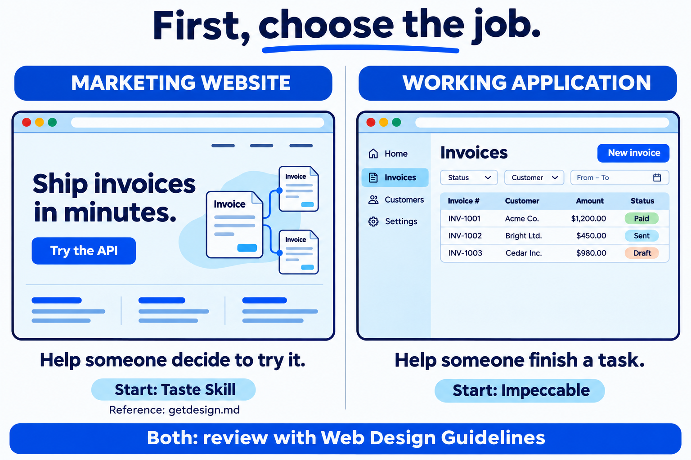
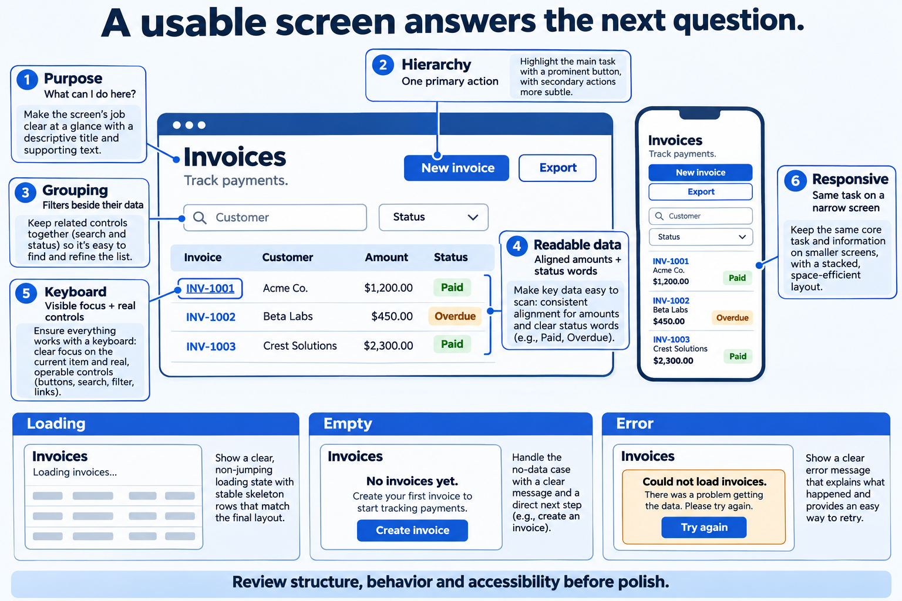
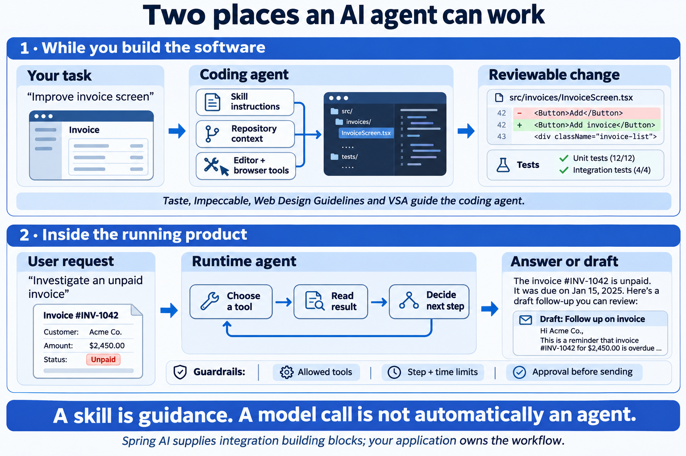
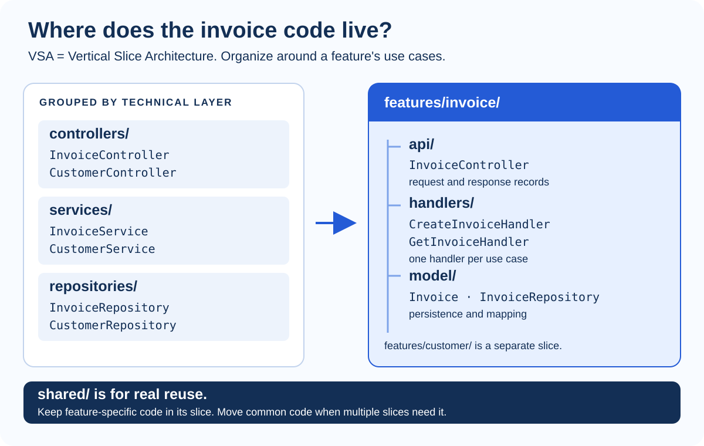
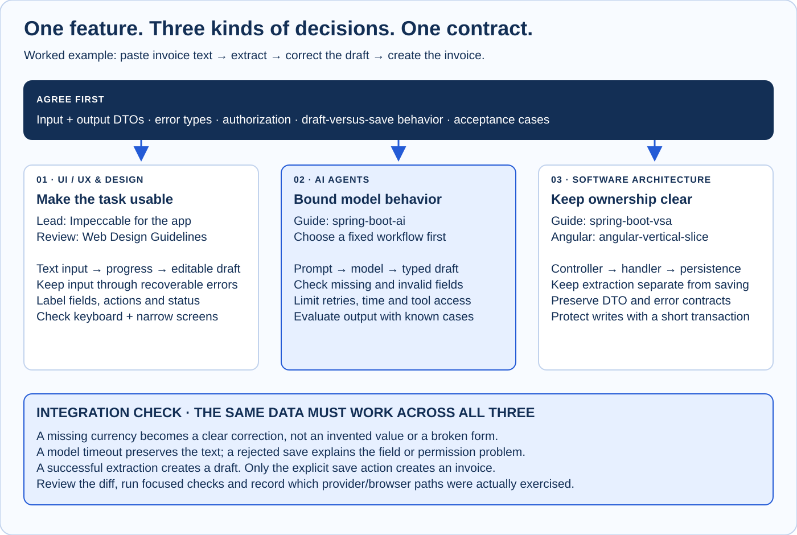

# Maxiplux Skills

**Build understandable screens, useful AI features, and maintainable applications.**

Three reusable coding-agent skills and an illustrated handbook called **Design without guessing**. Start with a task, choose the guidance you need, and check the result. You do not need a design background to follow the handbook; the code examples use Spring Boot and Angular.

**[Read the interactive handbook →](https://maxiplux.github.io/maxiplux-skills-handbook/)** · [Download the offline HTML](https://maxiplux.github.io/maxiplux-skills-handbook/desing/guide-lines.html) · [Read the Markdown chapters](./desing/guide-lines)

The handbook includes a tool chooser, an API-state demo, enlargable illustrations, copyable prompts, and print / PDF support. Reading it installs nothing. For offline use, save the HTML file and open it in a browser; its reading content, images, styles, and interactions are embedded. External references still need internet access.

## Start here

| What you want to do | Your next step |
| --- | --- |
| Understand the ideas before installing anything | Read the overview below, then open the [handbook](https://maxiplux.github.io/maxiplux-skills-handbook/) |
| Build or improve an application screen | Start with [UI / UX & Design](./desing/ui-ux-design.md); use Impeccable, then review the implementation |
| Build a public product or company website | Start with Taste; use a visual reference if you need direction |
| Organize a Spring Boot or Angular feature | Choose one of the [included skills](#skills-in-this-repository) |
| Extract fields or summarize text with a model | Read [AI Agents](./desing/ai-agents.md), then use the Spring AI skill |
| Connect the frontend, model, and backend | Follow the [complete invoice workflow](#one-example-from-screen-to-database) |

## The handbook in three parts

The same example connects all three parts: **paste invoice text → extract a draft → review and correct it → save an invoice**.

| Part | In plain language | What you learn |
| --- | --- | --- |
| **[01 · UI / UX & Design](./desing/ui-ux-design.md)** | Help a person understand and finish a task | Layout, forms, readable data, API states, accessibility, choosing tools, installation, and useful prompts |
| **[02 · AI Agents](./desing/ai-agents.md)** | Decide what a model may do and what your code must control | Coding versus runtime agents, tools, context, Spring AI, typed output, evaluation, permissions, and limits |
| **[03 · Software Architecture](./desing/software-architecture.md)** | Put behavior and data behind clear boundaries | Feature slices, Angular and Spring responsibilities, API contracts, transactions, errors, testing, and combining skills |

### 1. Make the screen understandable

**UI** is what someone sees and operates. **UX** is their whole journey, including waiting, correcting a mistake, and recovering from failure. A **design system** is the shared set of components and rules that keeps screens consistent.



Choose a tool by the job it needs to do:

| Resource | Use it for | Give it |
| --- | --- | --- |
| **[Impeccable](https://impeccable.style/)** | Build or improve an app screen; critique layout, clarify copy, handle failure states | A specific screen, the user's task, and what must stay |
| **[Taste Skill](https://github.com/Leonxlnx/taste-skill)** | Build or redesign a public-facing website | Audience, product story, assets, and one main action |
| **[Web Design Guidelines](https://github.com/vercel-labs/agent-skills/tree/main/skills/web-design-guidelines)** | Review UI code against web-interface rules | Actual UI files or file patterns |
| **[getdesign.md](https://getdesign.md/design-md)** | Find a visual reference to adapt | One relevant example and the ideas you want to borrow |

Taste and Impeccable overlap; these are suggested starting points. Keep your existing framework and component library. getdesign.md is a reference catalog, not a skill installer. These UI tools are external resources; the three local skills are listed below.



Look for **one clear main action**, related controls grouped together, aligned data, and status labels that do not depend on color alone. Five useful design terms: **hierarchy** (what stands out), **spacing** (how things are grouped), **typography** (how text is presented), **contrast** (what is readable), and **tokens** (reusable design values).

Every API state needs a usable screen:

| Situation | What the user needs |
| --- | --- |
| Loading | A progress message and a stable layout |
| Success | Readable records and a clear next action |
| No data yet | An explanation and a way to create the first record |
| No filter matches | A way to clear or adjust filters |
| Invalid input | A useful message beside the field; other input stays intact |
| Network or server failure | Preserved work and an appropriate recovery action |
| Permission denied | An explanation and the product's actual access-request process |

For forms, keep labels visible, explain required fields, prevent accidental duplicate submissions, and validate again on the server. A failed write can have an uncertain outcome; check its status before repeating it.

**Go deeper:** [forms and states](./desing/ui-ux-design.md#design-forms-and-every-api-state), [tool comparisons](./desing/ui-ux-design.md#choose-a-ui-resource), [copyable briefs](./desing/ui-ux-design.md#copy-a-ui-brief), and [review checklist and common questions](./desing/ui-ux-design.md#review-the-result-and-resolve-common-concerns).

### 2. Give AI a clear job

A **coding agent** helps you change software. A **runtime agent** operates inside the application your users run. Installing a coding skill gives your development agent instructions; it does not install a model or create an autonomous application.



Use ordinary code for calculations, authorization, and deterministic rules. Use one model call for interpretation, such as extracting invoice fields. Use a fixed workflow when the steps are known. Introduce an agent loop only when the next step needs to depend on observations.

For the invoice example, Spring AI sends text and a prompt to a model and maps the response into a Java record. Your code validates it and returns an **editable draft**. Saving is a separate user action. Check missing fields, malformed output, provider timeouts, permissions, and repeated actions.

**Go deeper:** [tools, context, MCP, retrieval, and memory](./desing/ai-agents.md#tools-context-and-the-control-loop), [Spring AI code and prompts](./desing/ai-agents.md#spring-ai-in-a-feature), and [evaluation and operations](./desing/ai-agents.md#evaluate-and-operate-the-feature).

### 3. Keep a feature together

**Vertical Slice Architecture (VSA)** groups code around a business feature. An invoice feature owns its HTTP interface, use-case handlers, and persistence model. Shared infrastructure holds concerns actually reused across features.



Keep controllers focused on HTTP, handlers focused on business decisions, and persistence behind explicit contracts. In Angular, the local skill separates typed API access from feature UI and state. Agree on request, response, and error shapes across both sides.

Keep database transactions short. For this example, model extraction and invoice saving are separate use cases, so a slow model request does not hold a database transaction open.

**Go deeper:** [feature boundaries](./desing/software-architecture.md#feature-boundaries-and-vsa), [request and failure flow](./desing/software-architecture.md#trace-a-request-through-the-system), and [combining architecture and AI skills](./desing/software-architecture.md#install-and-combine-architecture-skills).

*The illustrations are teaching examples. AI-generated screens, code snippets, invoices, and test counts are fictional examples, not evidence of this repository's test results. Text explanations accompany the visuals.*

## Skills in this repository

A **skill** is a folder containing instructions and optional references, scripts, or templates for a coding agent. Install only the ones needed by your project.

| Skill | What it helps with | Example request |
| --- | --- | --- |
| **[spring-boot-vsa](./spring-boot-vsa/SKILL.md)** | Scaffold, audit, or refactor Spring Boot features using API / handler / model boundaries | “Audit the invoice feature and explain the three most important issues.” |
| **[spring-boot-ai](./spring-boot-ai/SKILL.md)** | Spring AI `ChatClient`, typed output, external prompt templates, and broader Spring Boot patterns | “Extract invoice fields into a validated draft for user review.” |
| **[angular-vertical-slice](./angular-vertical-slice/SKILL.md)** | Organize Angular API access, feature components, state, routes, and tests | “Add an invoices feature using the project's Angular conventions.” |

When combining the Spring skills, let VSA guide structure and HTTP boundaries, and the AI references guide prompts and model integration. Preserve the project's agreed framework, migration tool, error contract, and logging policy when examples differ.

## Install the skills you need

**Run installation commands in a terminal. Send task prompts in your agent chat.** Reading the guide or installing a skill does not build a feature. Spring scaffolding also requires Python; a running AI feature needs compatible Spring AI dependencies and model/provider configuration.

### Get a local copy

With access to this repository, run:

```sh
git clone https://github.com/maxiplux/maxiplux-skills.git
cd maxiplux-skills
```

### Claude Code: use the included installer

Run from this repository. Replace the example application path with your own.

**Windows PowerShell:**

```powershell
# Both Spring skills in one application
.\install.ps1 -Project "C:\code\my-spring-app"

# Only the architecture skill
.\install.ps1 -Project "C:\code\my-spring-app" -Skill spring-boot-vsa

# Both Spring skills for all your projects
.\install.ps1 -Personal
```

**macOS, Linux, or Git Bash on Windows:**

```bash
bash ./install.sh --project /path/to/my-spring-app
bash ./install.sh --project /path/to/my-spring-app --skill spring-boot-vsa
bash ./install.sh --personal
```

Both installers default to the two Spring skills. To install Angular explicitly, use `-Skill angular-vertical-slice` in PowerShell or `--skill angular-vertical-slice` in Bash. `-Force` / `--force` replaces an existing installed copy; omit it to keep the overwrite prompt.

### Codex: use the Skills CLI

Run from the **application project** you want to change, with Node/npm installed. Replace the source path with your local clone:

```powershell
$skillSource = "C:/code/maxiplux-skills"
npx skills add $skillSource --skill spring-boot-vsa --agent codex --copy

# Add only when the task needs AI integration
npx skills add $skillSource --skill spring-boot-ai --agent codex --copy
```

For Angular, run this from the **frontend project**:

```powershell
npx skills add "C:/code/maxiplux-skills" --skill angular-vertical-slice --agent codex --copy
```

The [Skills CLI](https://github.com/vercel-labs/skills) uses project scope by default; `--copy` copies files instead of creating symlinks. See the [handbook installation guide](./desing/software-architecture.md#install-and-combine-architecture-skills) for context and verification.

<details>
<summary>Manual installation, verification, and removal</summary>

Copy the **whole skill folder**, including references, scripts, and assets:

| Agent | Project scope | Personal scope |
| --- | --- | --- |
| Claude Code | `<project>/.claude/skills/<skill-name>/` | `~/.claude/skills/<skill-name>/` |
| Codex | `<project>/.agents/skills/<skill-name>/` | `~/.agents/skills/<skill-name>/` |

Start or refresh an agent session in the target project if the skill does not appear. Ask:

```text
Use spring-boot-vsa. Tell me which SKILL.md you loaded, inspect this project's
feature layout, and recommend scaffold, audit, or refactor. Do not change files yet.
```

For Spring AI, ask which structured-output or prompt-template reference the agent loaded. Successful discovery does not prove that a model call or application feature works.

To uninstall, remove only the installed skill folder from the scope you chose. Keep the repository copy if you still want its documentation or templates.

</details>

### Add UI tools separately

Run these from the **frontend project**, installing only what your task needs. The handbook's checked prerequisites recommend Node **22.20+** for this combination; consult the linked upstream instructions for changes.

| Tool | Terminal command or action | First task in agent chat |
| --- | --- | --- |
| Impeccable | `npx impeccable install` — choose agent and project scope, then reload it | `$impeccable init`, then describe the audience and task; review the context it creates |
| Web Design Guidelines | `npx skills add https://github.com/vercel-labs/agent-skills --skill web-design-guidelines` | “Use web-design-guidelines to review these UI files.” |
| Taste | `npx skills add https://github.com/Leonxlnx/taste-skill --skill "design-taste-frontend"` | “Use design-taste-frontend to build our public product page.” |
| getdesign.md | Browse the [catalog](https://getdesign.md/design-md); choose a reference | Explain which layout, spacing, or typography ideas to adapt |

Impeccable's `$impeccable` examples use Codex syntax; supported agents may expose `/impeccable` instead. See [full UI installation and confirmation steps](./desing/ui-ux-design.md#install-ui-skills), including Taste's browser requirements and Impeccable context files.

Optional: [grill-me](https://github.com/mattpocock/skills) can help you work through a plan before implementation. Install with `npx skills add https://github.com/mattpocock/skills --skill grill-me`.

## One example, from screen to database



1. **Define the task.** Agree on the user, input, output, permissions, failure cases, and what success looks like.
2. **Organize the feature.** Use Spring VSA for backend boundaries and the Angular skill for frontend structure when applicable.
3. **Add interpretation.** Use Spring AI for extraction, an external prompt, typed output, and validation.
4. **Make it usable.** Use Impeccable for input, progress, editable results, correction, and explicit save.
5. **Review and verify.** Review UI code, audit relevant architecture boundaries, and exercise the whole journey with realistic data and failures.

Copy this into your agent chat and adapt it:

```text
Build an invoice-text-to-draft-to-save journey using our existing stack.
Agree on the user task, DTOs, errors, permissions, and acceptance criteria first.
Use spring-boot-vsa for backend structure; use angular-vertical-slice if we use Angular.
Use spring-boot-ai for extraction, external prompts, typed output, and evaluation.
Use Impeccable for the screen, preserving our component library and API contract.
Return an editable draft. Only the user's explicit save creates an invoice.
Cover incomplete extraction, invalid fields, provider failure, and duplicate saves.
Review UI code with web-design-guidelines and check the architecture boundaries.
Verify keyboard use and a narrow screen. Report changes, checks run, and open issues.
```

Stop when the acceptance criteria are met. Revisit a stage when a concrete issue or changed requirement calls for it.

## Maintain and publish the handbook

Edit the [UI/UX](./desing/ui-ux-design.md), [AI](./desing/ai-agents.md), or [architecture](./desing/software-architecture.md) chapter and keep section navigation in sync in [chapters.mjs](./desing/handbook/chapters.mjs). Then rebuild:

```sh
cd desing/handbook
npm ci
npm run build:pages
```

This regenerates the [offline HTML](./desing/guide-lines.html), prepares a complete site, and validates local links and images. The [Pages workflow](./.github/workflows/pages.yml) validates relevant pushes to `main` and uploads a build artifact. The public handbook is hosted separately in [maxiplux-skills-handbook](https://github.com/maxiplux/maxiplux-skills-handbook). Use `npm run build:public` to prepare that limited public bundle, then copy it into the hosting repository and push. See the [renderer and publishing guide](./desing/handbook/README.md) for details.

| Location | Contents |
| --- | --- |
| [spring-boot-ai/](./spring-boot-ai/) | AI skill and Spring references |
| [spring-boot-vsa/](./spring-boot-vsa/) | Architecture skill, examples, Python scaffolding, and templates |
| [angular-vertical-slice/](./angular-vertical-slice/) | Angular skill, references, and scaffolding |
| [desing/](./desing/) | Three handbook chapters, illustrations, and generated HTML |
| [desing/handbook/](./desing/handbook/) | HTML shell, styles, diagrams, and build scripts |
| [install.ps1](./install.ps1) / [install.sh](./install.sh) | Claude Code installers |

The existing folder name is spelled `desing`; commands and links use that spelling. Upstream references and their check dates are recorded in the [source index](./desing/guide-lines#sources--maintenance).
