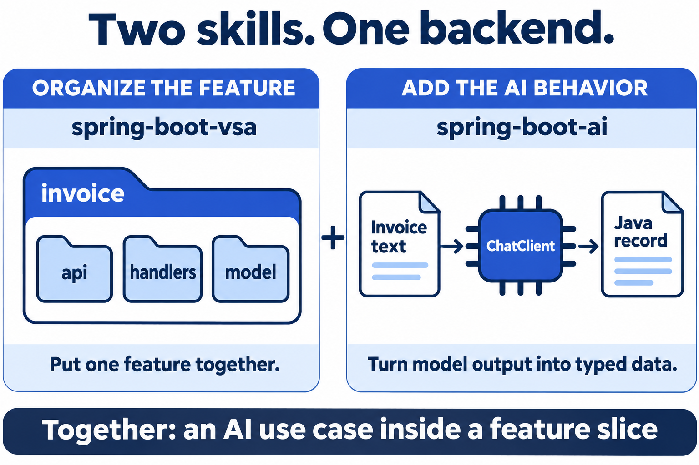
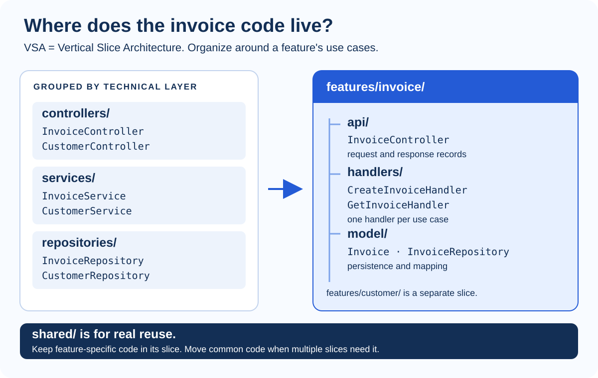

# Software Architecture

**Make ownership and boundaries explicit.** Architecture decides where behavior lives, what depends on what, how data changes and how failures travel back to the user. It does not decide the visual style or require a model.

## Feature Boundaries and VSA

**Use `spring-boot-vsa` to organize a feature. Use `spring-boot-ai` to implement AI behavior. Combine them when an AI use case belongs inside a Spring feature.** Use the full name **spring-boot-vsa** when installing or invoking the architecture skill.



*AI-generated teaching illustration. These skills guide a coding agent; they are not Java libraries, running services, or AI models.*

| Your actual task | Lead skill | What it should produce | When to skip it |
| --- | --- | --- | --- |
| Add normal invoice CRUD | **spring-boot-vsa** | A feature slice, request/response records, use-case handlers, error handling and API documentation | A tiny change that does not need structural work |
| Review a Spring feature's structure | **spring-boot-vsa**, audit mode | Blocker / Major / Minor findings with file:line evidence | A visual or CSS problem |
| Reorganize a layered backend | **spring-boot-vsa**, refactor mode | A feature-by-feature migration that preserves behavior | The project intentionally uses another architecture |
| Extract fields or generate a typed summary using a model | **spring-boot-ai** | ChatClient integration, prompts and typed output mapping | SQL, validation or normal Java logic already solves it reliably |
| Add AI to a new feature | **Both**, with explicit scopes | A VSA handler containing the AI use case | No need to introduce a model just to use both skills |
| Fix the screen for that feature | **Impeccable**, then UI review as needed | A usable frontend with appropriate API states | A backend-only change |

This is recommended routing. The [spring-boot-ai description](../spring-boot-ai/SKILL.md) also matches broad Spring Boot work and includes general backend guidance. It overlaps with VSA; it is not restricted to AI tasks. Give the agent a narrow task and the precedence rules in the installation and combination section below.

### VSA in One Picture: Keep One Feature Together

**Vertical Slice Architecture** groups code by business feature. Instead of searching several top-level technical folders to change invoices, start in the invoice slice. It still has an API boundary, business logic and persistence; they live close to the feature that owns them.



[Open the VSA SVG separately](./assets/vsa-feature-slice.svg) to zoom in or reuse the editable diagram.

| Inside the slice | Plain meaning | Example |
| --- | --- | --- |
| `api/` | HTTP translation: accept a request, invoke a handler, return a response | `InvoiceController`, request and response records |
| `handlers/` | One use case and its business decisions | `CreateInvoiceHandler.handle(...)`, `GetInvoiceHandler.handle(...)` |
| `model/` | Persistence and mapping for this feature | `Invoice`, `InvoiceRepository`, `InvoiceMapper` |
| Optional `events/`, `enums/`, `exception/` | Feature-specific supporting types, when needed | An invoice event or domain exception |
| `shared/` outside the slice | Infrastructure or concepts actually reused by multiple slices | The common exception handler |

The [VSA skill](../spring-boot-vsa/SKILL.md) also covers handler transactions, bounded queries, validation, DTO records, OpenAPI examples and a shared `ProblemDetail` error boundary for Boot 3. Its scaffold uses Lombok and expects the relevant application dependencies. A generated folder structure is a starting point; the business logic still has to be implemented and checked.

### Choose the VSA Operation Before You Ask

| Operation | Use it when | What to expect |
| --- | --- | --- |
| **Scaffold** | A new feature needs its first files | Inspect the project, initialize shared infrastructure if needed, generate the slice, then implement the requested behavior |
| **Audit** | You want to understand problems before changing code | Prioritized findings and suggestions; the audit itself makes no fixes |
| **Refactor** | Existing code should follow VSA | Move one feature at a time, update imports and tests, preserve contracts and transaction behavior |

```text
Use spring-boot-vsa in audit mode for the invoice feature.
Check the controller/handler boundary, request and response records,
transactions, bounded queries, error handling, logging and OpenAPI examples.
Return Blocker / Major / Minor findings with file:line evidence.
Explain the three most important fixes first. Do not change files yet.
```

### A Folder Tree Is Only the Start

VSA groups a business capability; it does not require microservices. Start with explicit boundaries inside the application you already have. A feature remains understandable when its behavior, contracts and tests change together.

| Boundary | Keep here | Avoid |
| --- | --- | --- |
| Controller | HTTP input, validation, handler invocation, response mapping | Database queries and model orchestration in the endpoint |
| Handler | One use case, business decisions and the intended transaction boundary | An all-purpose service that owns unrelated features |
| Model/repository | Feature-owned persistence, queries and mapping | Returning JPA entities as the public HTTP contract |
| Shared infrastructure | Proven common concerns such as error translation | Moving every helper into a global utility folder |
| Another feature | Use an explicit public contract or application boundary | Reaching into its internals and creating cyclic dependencies |

The first four rows reflect the local [VSA conventions](../spring-boot-vsa/SKILL.md). Explicit cross-feature contracts are this handbook's recommendation; choose the interaction style with the project rather than inventing a universal ban on reuse.

### Angular and Spring Slices Are Related, but Their Folders Differ

The repository also contains [angular-vertical-slice](../angular-vertical-slice/SKILL.md). It addresses **frontend code architecture**, while Taste and Impeccable address visual and interaction work. Use both when implementing an Angular feature, giving each a defined responsibility.

| In the Angular skill | Responsibility | Connection to Spring |
| --- | --- | --- |
| `core/invoices/` | API DTOs and a typed, stateless HTTP service | Mirrors the backend request/response contract |
| `features/invoices/` | Containers, presenters, local state, validators and error messages | Converts responses and failures into UI behavior |
| `shared/` | UI used by more than one slice | Reuse a component without importing another feature's internals |
| `app.routes.ts` and layout navigation | Lazy route and a way to reach the screen | A route guard assists navigation; backend authorization remains required |

Here `core/invoices` and `features/invoices` are two parts of one capability. The local Angular skill forbids `core` importing `features`, and feature slices importing each other's components. Its conventions target the project's compatible Angular version; inspect the actual project before adopting version-specific APIs.

## Trace a Request Through the System


### Walk the Successful Request

1. The caller submits the reviewed fields. The backend establishes identity and checks access to the operation and tenant data.
2. The controller validates the request shape and calls the feature's handler.
3. The handler enforces business rules and controls the atomic data change. Repeated writes need the project's idempotency or duplicate-detection strategy.
4. The repository performs bounded database work; constraints protect persisted data.
5. The application maps its result to the API response contract. The UI confirms the actual outcome.

For the AI example, **extracting a draft and saving an invoice are different use cases**. The model call can be slow or fail. Avoid holding a database transaction open across it; validate the draft and perform any eventual write in its own appropriately bounded transaction. This separation is the handbook's design recommendation for this example.

### Follow the Failure Back to the Person

| Failure | Owning boundary | What the client needs |
| --- | --- | --- |
| Unauthenticated or unauthorized caller | Security configuration / access checks | A consistent 401/403 response and an appropriate sign-in/access action |
| Invalid request field | Validation and HTTP error translation | Stable field information and a correction message |
| Domain rule rejects the action | Use-case handler → shared error advice | A stable problem type and useful next action |
| Database conflict or unexpected failure | Persistence/use case → shared error advice | A safe failure contract; no internal stack trace in the response |
| Model/provider or conversion failure | AI use case → agreed HTTP error translation | Preserve source text and explain recovery or manual entry |

The local VSA skill uses a shared `GlobalExceptionHandler` and Boot 3 `ProblemDetail` for controller/handler errors. Security filters can fail before controller advice is reached, so configure their response path too. Log once at the chosen boundary with a correlation ID; follow the project's adopted policy described in the comparison below.

### Architecture Decisions That the Diagrams Must Not Hide

| Decision | Ask before implementing | Evidence |
| --- | --- | --- |
| Contract evolution | Are request fields optional, nullable or required? Are error types stable? | DTOs, OpenAPI examples and contract checks |
| Persistence | Which writes must succeed together? What happens on a duplicate? | Transaction boundary, constraints and failure tests |
| Schema changes | Which migration tool and rollout order does the project use? | Reviewed migration and compatibility with deployed code |
| Data access | Is this query bounded and scoped to the caller? | Query behavior with realistic data and authorization tests |
| External services | What are timeout, retry and cancellation rules? | Explicit policies and simulated failure cases |
| Observability | Can you trace a user failure across boundaries? | Correlation IDs, useful events and redacted diagnostics |

### Match the Test to the Boundary

| Check | What it proves | What it cannot prove alone |
| --- | --- | --- |
| Handler unit test | Business decisions for known inputs | Real SQL or model quality |
| HTTP/controller test | Status, validation and response/error contract | The complete browser interaction |
| Repository integration test | Queries, constraints and transactions against a suitable database | The frontend's state handling |
| Provider stub test | Predictable timeout, malformed-output and retry behavior | Real provider compatibility or output quality |
| Model evaluation | Output behavior on representative cases | Deterministic correctness for every future response |
| Browser journey | A person can complete and recover from the task | Every internal business or security invariant |

```text
Use spring-boot-vsa to implement the reviewed invoice-creation use case.
Keep the controller thin and DTOs explicit. Put business rules in the handler.
Scope access to the authenticated caller and tenant. Preserve the API error contract.
Keep model extraction separate from the database write transaction.
Use our migration and duplicate-write strategy; do not infer them from a template.
Verify the affected HTTP, handler and persistence boundaries and report the evidence.
```

## Install and Combine Architecture Skills

**Install a skill before asking the agent to follow it in the target backend project. Add runtime dependencies only when implementing a feature that needs them.** Reading this handbook executes no installers or model requests.

| You are setting up… | What you need | What installation changes |
| --- | --- | --- |
| The agent's guidance | The selected skill folder, including its references, scripts and assets | The agent can discover and follow the skill |
| A VSA scaffold | An existing Spring Boot project; Python for the scaffold scripts; application dependencies required by the generated code | The agent can create feature skeletons; the skill does not create a complete Boot application |
| A running AI feature | Compatible Spring AI dependencies, a model connection and provider configuration | The application can make model requests; any credentials belong in environment/configuration, not copied into prompts |

### Codex: Install into the Backend Project

Use Node/npm as described in [UI installation prerequisites](./ui-ux-design.md#install-ui-skills). Open a terminal **in the backend project you want to change**. This example uses the local skills checkout reviewed by this handbook; change the source path if you moved it.

```powershell
$skillSource = "C:/code/maxiplux-skills"
npx skills add $skillSource --skill spring-boot-vsa --agent codex --copy
```

Install the AI skill when you need it:

```powershell
$skillSource = "C:/code/maxiplux-skills"
npx skills add $skillSource --skill spring-boot-ai --agent codex --copy
```

The Skills CLI accepts a local source and named skill selection; `--copy` copies files instead of creating symlinks. Project scope is the default. See the [CLI commands](https://github.com/vercel-labs/skills/blob/main/docs/commands.md). Codex discovers project skills under `.agents/skills`; see [official skill discovery guidance](https://learn.chatgpt.com/docs/build-skills). Keep the whole skill directory, not only its entry document.

### Claude Code: Use This Repository's Installer

Run this from the **skills repository root**. Replace the example target with your existing backend project:

```powershell
.\install.ps1 -Project "D:\Projects\billing-api" -Skill spring-boot-vsa
```

For both skills, omit `-Skill`:

```powershell
.\install.ps1 -Project "D:\Projects\billing-api"
```

The local [PowerShell installer](../install.ps1) targets `.claude/skills`. Its `-Personal` option targets the current user's Claude skills directory. The [shell installer](../install.sh) provides the corresponding `--project`, `--personal` and `--skill` options. Choose the installer for the agent you actually use.

### Confirm the Agent Can Use the Skill

Start or refresh a session in the target backend project if the skill does not appear. Ask this before a large implementation:

```text
Use spring-boot-vsa. Tell me which SKILL.md you loaded, identify this project's
base package and current feature layout, and recommend scaffold, audit or refactor.
Inspect first; do not change files yet.
```

For the AI skill, ask it to load `spring-boot-ai`, identify the project's Spring AI version and relevant reference, and state any missing runtime configuration. Skill discovery and a successful application/model call are separate checks.

### Combining Them: Give Each Skill a Clear Responsibility

The local documents have overlapping guidance and some different examples. **The project requirements come first. For this combined workflow, use VSA for architecture and HTTP boundaries; use the AI references for prompts, model calls and output mapping.** This is an explicit integration recommendation, not an automatic conflict-resolution feature.

| Topic | Difference to notice | Instruction to give the agent |
| --- | --- | --- |
| Feature structure | Both discuss VSA; the VSA skill gives the scaffold/audit/refactor workflow | Let spring-boot-vsa own slice layout and handler boundaries |
| HTTP errors | VSA uses Boot 3 `ProblemDetail`; the AI patterns reference includes a custom error DTO | Preserve the agreed project contract; for the VSA workflow use its shared exception boundary |
| Failure logging | VSA requires ERROR once at the HTTP boundary, with stack traces for 5xx; AI examples include WARN for some expected failures | Apply one chosen policy; avoid logging the same exception in handler and advice |
| MVC and migrations | AI guidance prescribes servlet MVC and Flyway; VSA is agnostic about these choices | Preserve declared project choices; explicitly narrow AI use to its AI references if those prescriptions conflict |
| API versions | Reference examples may target a different library release | Verify imports and APIs against the application's pinned versions before copying code |

### One Feature, from Backend to Screen

| Step | Give the agent this job | Evidence to look for |
| --- | --- | --- |
| **1. Define** | Agree on invoice extraction input, draft output and error responses | A concrete contract and review-before-save behavior |
| **2. Organize — VSA** | Create or extend the invoice slice and its extraction handler | Thin controller, explicit request/response records, clear use-case boundary |
| **3. Implement — Spring AI** | Add the model call, prompt resource, mapping and validation | Realistic valid, incomplete and failed extraction cases are handled |
| **4. Present — Impeccable** | Build the text input, loading state, editable draft and recovery UI | The user can review and correct extracted fields |
| **5. Review** | Audit backend behavior, review UI guidelines, then exercise the flow | State what was tested with doubles, in the browser and with a real provider |

```text
Build an invoice-extraction draft feature using spring-boot-vsa and spring-boot-ai.
Use VSA for feature folders, handlers, HTTP contracts and the agreed logging policy.
Use the AI skill's prompt and structured-output references for the model integration.
Keep our declared stack and migration tool. Verify APIs against our pinned versions.
Return an editable draft; creating an invoice is a separate confirmed user action.
Cover valid output, missing fields, invalid values, provider failure and conversion failure.
Then use Impeccable for the review screen, preserving the same API contract and states.
Report implemented behavior, checks actually run and remaining configuration.
```

## Deliver One Complete Feature


### Carry the Same Example Across All Three Parts

| Stage | Decision or artifact to carry forward | Lead guidance |
| --- | --- | --- |
| Agree the job | Audience, task, input, draft output, error cases and acceptance criteria | Your product requirements |
| Define ownership | Feature boundaries, DTOs, handler responsibilities and persistence | spring-boot-vsa; angular-vertical-slice when applicable |
| Add interpretation | Prompt resource, typed mapping, validation and evaluation cases | spring-boot-ai |
| Make it usable | Input, progress, editable draft, correction and explicit save | Impeccable; Taste when building the public website |
| Review implementation | UI findings, architecture findings and resolved changes | Web Design Guidelines + focused VSA audit |
| Check the whole task | Realistic data, failures, keyboard use, narrow screen and integration evidence | Application checks and browser verification |

**Stop when the acceptance criteria are met.** Do not keep passing the same feature between tools to obtain different aesthetic opinions. Reopen a stage when a concrete failure, changed requirement or unresolved finding justifies it.

### Keep Responsibility Clear When Skills Overlap

Use the project's requirements and declared stack as the common brief. Let UI skills handle presentation, the Angular skill handle frontend structure, VSA handle backend structure, and the AI references handle model integration. If two recommendations conflict, resolve that decision explicitly before applying both.

For Angular, install the local skill from the target frontend project using the same Skills CLI route:

```powershell
$skillSource = "C:/code/maxiplux-skills"
npx skills add $skillSource --skill angular-vertical-slice --agent codex --copy
```

The repository's installer defaults to the two Spring skills; it does not include Angular in that default list. Use the named CLI selection above when adding Angular guidance. Installing a skill supplies instructions, not a framework upgrade.

### A Complete Implementation Brief

```text
Implement the invoice-text-to-draft-to-save journey using our existing stack.
Agree input/output DTOs, errors, permission rules and acceptance cases first.
Use spring-boot-vsa for backend structure and angular-vertical-slice for Angular structure.
Use spring-boot-ai for extraction, external prompts, typed output and model evaluations.
Use Impeccable for interaction and presentation; preserve our component library.
Extraction must return an editable draft. Only the user's explicit save creates an invoice.
Cover incomplete extraction, invalid fields, provider failure and duplicate save attempts.
Review UI code with web-design-guidelines and inspect the architecture boundaries.
Report the final behavior, checks actually run and any unresolved requirement.
```

<details class="collapse collapse-plus border border-base-300 my-3">
<summary class="collapse-title">Are spring-vsa and spring-boot-vsa different skills?</summary>
<div class="collapse-content">

In this guide, “spring-vsa” refers to this repository's [spring-boot-vsa](../spring-boot-vsa/SKILL.md). Install and invoke the full name so the agent loads the intended skill.

</div>
</details>
