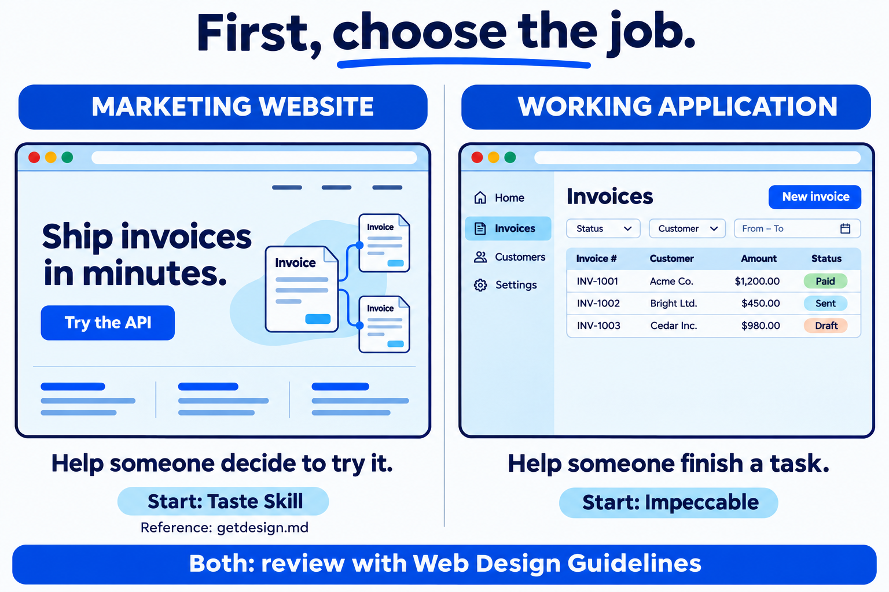
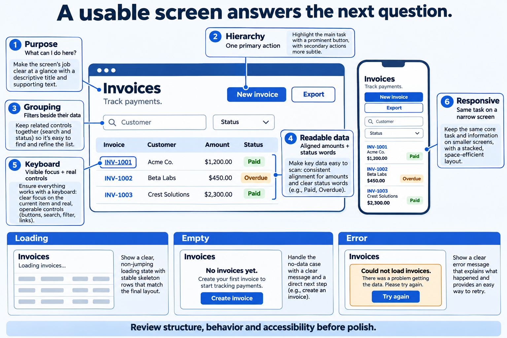
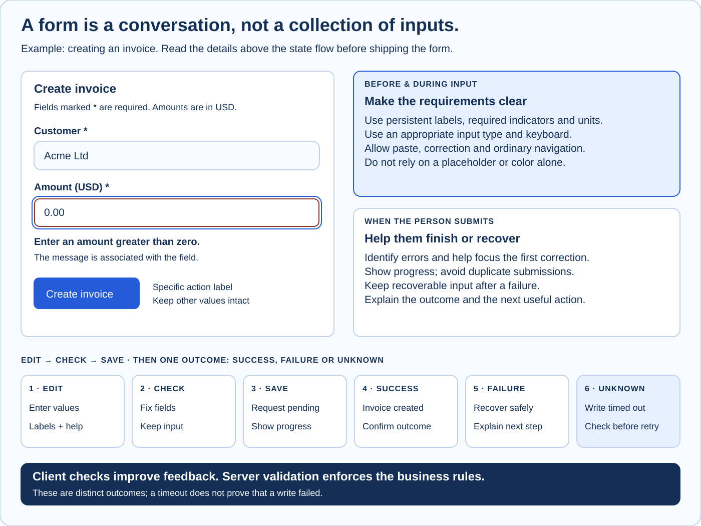

# UI / UX & Design

**Make the task understandable, usable and consistent.** UI is what a person sees and operates. UX is the whole path to completing their goal, including waiting, correcting mistakes and recovering from failure. A design system makes repeated decisions consistent.

## Choose the Job Before the Tool

You already know how to model data and handle failures. Apply the same thinking to a screen: **who uses it, what must they do, and what happens when something goes wrong?** Start there. Colors come later.

**Your default for a CRUD app, dashboard, or internal tool:** keep the existing component library, use **Impeccable** to build or improve one screen, then use **Web Design Guidelines** to review its code. This is this handbook's recommended starting point, not a restriction on what the tools can do.

<!-- TOOL_PICKER -->



*Illustrated examples, not screenshots of actual tool output. Taste and Impeccable overlap; the recommendation reflects the kind of work you are doing.*

| Ask yourself | If your answer is… | Start here |
| --- | --- | --- |
| What must the visitor do? | Understand the product and try it | Taste Skill for the marketing site |
| What must the user do? | Create an invoice, filter records, fix a failed job | Impeccable for the application screen |
| What is missing? | A visual direction or reference | Browse getdesign.md; choose one reference |
| What is wrong? | It works, but it is crowded or confusing | Impeccable critique, then a focused fix |
| What needs checking? | Labels, focus, forms, keyboard support, web conventions | Web Design Guidelines on specific UI files |
| Where should backend code go? | A Spring feature needs scaffolding, review, or refactoring | spring-boot-vsa; see [Software Architecture](./software-architecture.md) |
| How do I add AI behavior? | Extract fields, summarize text, or map model output to Java | spring-boot-ai; see [AI Agents](./ai-agents.md) |

**Choose only the UI resources needed for this task.** getdesign.md is a catalog of reference documents. The other three provide agent skills or tooling. None replaces your frontend framework or component library.

## Recognize Useful Visual Structure

Three related questions need separate answers:

| Layer | Question | Invoice example |
| --- | --- | --- |
| **UX — the task** | Can the person finish and recover? | Find an overdue invoice, correct a draft, retry a failed read without losing work |
| **UI — the controls** | Is the next action understandable and reachable? | Labelled filters, readable amounts, a clear Create invoice action |
| **Design system — consistency** | Will the same idea look and behave the same elsewhere? | Reuse the same button, spacing, type and status tokens |



*An AI-generated teaching illustration. It shows principles to discuss with your agent, not a measured result or a pixel-perfect implementation target.*

| What to notice | Backend analogy | What to ask the agent |
| --- | --- | --- |
| **One primary action** stands out | One clear entry point for a use case | “Make New invoice the main action. Keep Export secondary.” |
| **Related elements sit together** | Keep related behavior in the same feature | “Put filters beside the records they affect.” |
| **Rows, labels, and amounts line up** | Consistent structure makes data easier to compare | “Align money amounts and use consistent row spacing.” |
| **Color has a text label** | An enum has a meaningful name | “Show Overdue as text, not only a red dot.” |

### Five Design Words You Actually Need

<!-- DESIGN_VOCABULARY -->

- **Hierarchy:** the order in which your eye notices things. Give the page title and main action more emphasis than supporting information.
- **Spacing:** the gaps inside and between things. Use smaller gaps for related fields and larger gaps between sections.
- **Typography:** how text uses size, weight, and line length. Prefer a few consistent styles over a different font everywhere.
- **Contrast:** how easily text or controls can be distinguished from their background. Check it in the real interface; a pretty screenshot cannot establish accessibility.
- **Design tokens:** named values reused across the UI, like shared constants: `space-2`, `text-body`, `color-error`. Your component library may already supply them.

For a new internal tool with no brand guidance, ask for a neutral surface, one action color, the existing or system font, and a consistent spacing scale. These are starting constraints, not universal design laws. Avoid changing the whole visual system to fix one form.

## Design Forms and Every API State



### Read the Form Diagram

1. **Before typing:** say which fields are required, name the expected unit and give helpful instructions.
2. **While editing:** retain entered values and allow ordinary editing and paste.
3. **On submit:** associate each error with its field and help the person reach the first correction.
4. **While saving:** show progress and prevent accidental duplicate submission. The server still needs a deliberate duplicate-write strategy.
5. **After failure:** keep recoverable input. A network timeout can leave a write's result unknown; check its status before blindly repeating it.
6. **After success:** confirm the outcome and provide a useful next action.

Client validation improves feedback, but the server must validate input too. Required indicators and error notifications must be understandable to assistive technology. See [W3C form validation](https://www.w3.org/WAI/tutorials/forms/validation/). The invoice lifecycle is this handbook's worked example.

Your successful API response is only one version of the screen. Design the other states deliberately. The status codes below are examples; map them to your API contract.

<!-- STATE_PLAYGROUND -->

| Backend situation | What the person should see | Recovery or next action |
| --- | --- | --- |
| Request pending | “Loading invoices…” with a stable layout | Wait; prevent repeated submission of the same write |
| 200 with records | A readable list with clear status and actions | Inspect or create an invoice |
| 200 with an empty list | “No invoices yet” and an explanation | Create the first invoice |
| Filter matches nothing | “No invoices match these filters” | Clear or adjust the filters |
| Validation failure, e.g. 422 | A useful message beside the relevant field | Correct the field; preserve other input |
| Server/network failure, e.g. 503 | A plain-language failure message | Retry a safe read; preserve work and handle duplicate writes deliberately |
| Permission denied, e.g. 403 | Explain that access is restricted | Request access through the product's actual process |

Use Impeccable `harden` for robustness and `clarify` for confusing copy. Then check the implementation and real behavior. See the [harden reference](https://impeccable.style/docs/harden/).

## Choose a UI Resource

Pick one lead tool for a change and give the others a specific follow-up task.

| Resource | What you give it | What you get | Choose something else when… |
| --- | --- | --- | --- |
| **getdesign.md — reference** | A site or style that fits your product | A DESIGN.md analysis to adapt as context | You need someone to implement or review code |
| **Taste Skill — create / redesign** | Business, audience, page goal, assets, constraints | A website-building workflow with visual direction and browser checks | You are making a small change inside an established admin app |
| **Impeccable — create / improve** | A screen, user task, and what must stay | A new design or focused critique, layout, copy, and polish work | You only need a specific standards-oriented code review |
| **Web Design Guidelines — review** | UI source files or file patterns | Findings tied to the current upstream interface rules | You need a visual concept or a complete new screen |

Descriptions are grounded in the [getdesign.md catalog](https://getdesign.md/design-md), [Taste documentation](https://github.com/Leonxlnx/taste-skill), [Impeccable workflows](https://impeccable.style/docs/new-work/), and [Vercel skill](https://github.com/vercel-labs/agent-skills/tree/main/skills/web-design-guidelines). The suggested routing is this handbook's recommendation.

### Taste or Impeccable?

For a company website with a hero, product story, and sign-up action, start with Taste. For an invoice table, settings page, or existing product screen, start with Impeccable. Impeccable also builds new websites; you do not need to switch if it is already working well for your project.

### Impeccable Audit or Web Design Guidelines?

Impeccable `audit` is a broad technical quality pass; `critique` evaluates the design and usability. Web Design Guidelines checks specified code against a particular set of web-interface rules. Use the review that answers your question; if you run both, deduplicate findings. A report does not mean fixes have been implemented. See [Impeccable commands](https://impeccable.style/docs/) and the [Vercel rules](https://github.com/vercel-labs/web-interface-guidelines/blob/main/command.md).

## Install UI Skills

**Terminal commands install tools. Chat prompts ask the agent to use them.** Run installers in the frontend project you want to improve, which may differ from this skills repository. Opening this handbook installs nothing.

### Before You Install

Run these in your terminal:

```powershell
node --version
npm --version
```

The current Skills CLI requires Node **22.20+**. Taste's scripts require Node **22+** plus Chrome, Edge, or Chromium; ffmpeg is optional. Impeccable's current setup guide requires Node **18.19+**. Node 22.20+ meets these stated minimums. Sources: [Skills CLI](https://github.com/vercel-labs/skills), [Taste installation](https://github.com/Leonxlnx/taste-skill#install), [Impeccable installation](https://impeccable.style/tutorials/getting-started/).

**Scope:** choose project installation first. Use global installation when you want the skill across projects. Select your coding agent. Install once per chosen scope, then invoke it for each task; do not reinstall for every screen.

### A. Impeccable — Application UI

**Install when:** you are ready to build a screen or improve an existing one.

In the terminal, from the frontend project root:

```powershell
npx impeccable install
```

Choose your coding tool and project scope, then reload the coding tool. If you enable its optional automatic hook, complete the approval steps shown for your tool. See the [installer guide](https://impeccable.style/tutorials/getting-started/).

In your **agent chat** (Codex syntax shown):

```text
$impeccable init
```

Describe the audience and task. Review the resulting `PRODUCT.md`. If a visual style already exists, run `$impeccable document` and review the resulting `DESIGN.md`; skip that step for an unstyled scaffold. See [context files](https://impeccable.style/docs/context/).

**Confirm it works:** ask for `$impeccable critique the invoices screen`. Expect findings about that screen. For agents using slash commands, use `/impeccable` in place of `$impeccable`, as documented by Impeccable.

### B. Web Design Guidelines — Code Review

**Install when:** you have UI files ready to review.

In the terminal:

```powershell
npx skills add https://github.com/vercel-labs/agent-skills --skill web-design-guidelines
```

In your agent chat:

```text
Use the installed web-design-guidelines skill to review the invoice UI files.
Fetch the current guidelines and give actionable file:line findings.
Review first; do not apply fixes until I have read the findings.
```

Replace “invoice UI files” with actual files or patterns. **Confirm it works:** the agent reads those files and reports findings, or explicitly reports no findings within that scope. This skill does not certify accessibility. [Upstream skill](https://github.com/vercel-labs/agent-skills/tree/main/skills/web-design-guidelines).

### C. Taste Skill — Public Website

**Install when:** you will build or redesign a marketing or company website.

In the terminal:

```powershell
npx skills add https://github.com/Leonxlnx/taste-skill --skill "design-taste-frontend"
```

In your agent chat:

```text
Use design-taste-frontend to build the public page for our invoice API.
Audience: developers. Goal: understand the API and try the sandbox.
Show a clear value proposition, a real product example, and one main action.
Keep our framework and confirmed brand rules. Check the running result.
```

**Confirm it works:** the agent loads the named skill and follows its planning/build/check workflow. Current Taste guidance is particularly oriented toward company websites. [Upstream documentation](https://github.com/Leonxlnx/taste-skill).

### D. getdesign.md — Visual Reference

**Use when:** you need inspiration. There is **no skill installer** for this catalog workflow.

1. Browse [getdesign.md](https://getdesign.md/design-md) and choose one relevant reference; check its access terms.
2. Save the analysis under a clear name, for example `docs/design-reference.md` in your frontend project. This is a suggested filename, not an existing file here.
3. Tell the agent what to borrow: “Use the spacing and typography as inspiration; preserve our product name, content, and component library.”
4. Keep your project's own `DESIGN.md` separate. Inspiration describes a possible direction; project rules describe decisions you adopted.

### Already Installed, but Nothing Happens?

Check project folder, installation scope, and selected agent; reload or start a new agent session if needed. Ask the agent to name the skill it loaded. For Skills CLI installations, `npx skills list` lists skills and `npx skills check` checks updates. For the Impeccable installer route, update with `npx impeccable update`. Use the same installation method for maintenance. [Skills CLI](https://github.com/vercel-labs/skills) · [Impeccable setup](https://impeccable.style/tutorials/getting-started/).

## Combine UI Skills

**One brief → one lead tool → one focused review → verify.** Give each tool the same task, behavior requirements, and design constraints.

<!-- WORKFLOW_RECIPES -->

| Situation | A useful sequence | Carry forward |
| --- | --- | --- |
| New CRUD screen | Brief → Impeccable build → Web Design Guidelines → browser checks | Task, component library, fields, API states |
| Existing UI feels confusing | Impeccable critique → pick the top issue → targeted change → review | What worked before, what changed |
| Public product website | Optional getdesign.md reference → Taste → optional Impeccable refinement → review | Audience, main action, visual direction |
| Existing design system | Read its rules → reuse components → focused implementation → review | Tokens and component behavior |

If tools disagree about aesthetics, choose what fits the brief and existing system. If a suggestion conflicts with keyboard access, readability, or required behavior, keep those requirements and find another visual solution. These priorities are recommended practice, not a guarantee that tools agree automatically.

For a crowded screen, `layout` is more specific than “make it beautiful.” For an unclear problem, start with `critique`. Sources: [layout](https://impeccable.style/docs/layout/) and [critique](https://impeccable.style/docs/critique/).

## Copy a UI Brief

Edit these examples to match your audience, screen, and framework. You do not need color theory to give a useful brief.

### A Complete Brief for a New App Screen

```text
Use Impeccable to design and build an invoice-management screen.
Audience: a small business owner who checks payments daily.
Main task: find overdue invoices and create a new invoice.
Stack: Angular frontend with an existing Spring Boot API.
Keep the current component library, routes, API contracts, and working behavior.
Use the existing design system; if none exists, propose a simple consistent one.
Include loading, populated, empty, no-results, validation, failure, and permission states.
Start with a simple layout and explain the main action before implementing it.
Verify keyboard use and a narrow viewport. Report what you checked and what remains.
```

### “It Works, but Something Feels Wrong”

```text
$impeccable critique the invoices screen.
Evaluate whether a new user can find an overdue invoice and create one.
Show the three most important issues with an annotated screenshot if available.
Explain each issue in plain language and suggest one concrete fix.
Keep the existing brand and working behavior. Review first.
```

### “I Know the Problem; Fix Only This”

```text
$impeccable layout the invoices screen.
Make New invoice the clearest action, align amounts, and group filters with the table.
Preserve the component library, data, routes, and API behavior.
Show the before/after and explain what changed.
```

### “The Happy Path Is Done”

```text
$impeccable harden the invoice form.
Handle slow requests, field validation, server failures, and permission errors.
Keep typed values after recoverable failures and prevent duplicate submissions.
Show a clear next action for each state. Check keyboard focus and long content.
```

## Review the Result and Resolve Common Concerns

### Use Web Design Guidelines as an Implementation Review

Run the installed `web-design-guidelines` skill against named UI files. It fetches the current rules and reports concrete code findings. In a tool with slash commands, select `/web-design-guidelines` if it is exposed; otherwise name the skill in chat. An audit report and implemented fixes are separate results.

| Review area | Evidence to inspect in the real page |
| --- | --- |
| Semantics & access | Controls have names, images have useful alternatives, headings form a hierarchy |
| Keyboard & focus | Reach and operate controls; overlays close and return focus |
| Forms & recovery | Labels, understandable errors, retained input and useful recovery |
| Responsive content | Zoom, long labels, narrow screens and deliberate table scrolling |
| Navigation & state | Shareable locations, working history and state that survives navigation |
| Motion & performance | Reduced motion, stable image sizes and responsive interaction |

These categories summarize the [current Vercel review rules](https://github.com/vercel-labs/web-interface-guidelines/blob/main/command.md); they are not an accessibility certification. Inspect behavior as well as source code.

```text
Use web-design-guidelines to review the specified UI files and running page.
Fetch the current rules. Check the main task, keyboard focus, form errors,
responsive content, image alternatives, navigation state and motion preferences.
Report actionable file:line findings, separating code findings from browser checks.
Fix the agreed issues, then exercise the affected behavior again.
```

### Turn “looks Better” into a Checkable Result

Try a real task, not just a screenshot. Give the agent observable acceptance criteria.

| Check | A useful pass condition |
| --- | --- |
| Find the next action | A new user can identify the screen's purpose and main action without explanation |
| Complete the task | Create or find the intended record without guessing which control to use |
| Recover from failure | Field errors explain the fix; failed requests preserve recoverable input |
| Use the keyboard | Controls are reachable, have visible focus, and operate with the keyboard |
| Read on a small screen | Main content and actions remain usable; wide tables have intentional scroll or an alternate layout |
| Handle realistic data | Long names, large amounts, empty lists, and many rows remain understandable |
| Keep it consistent | Similar buttons, fields, spacing, and statuses behave consistently across screens |
| Verify evidence | The agent distinguishes source review, browser checks, and tests it actually ran |

These checks complement accessibility and business testing. They focus your first review on behavior you can observe.

<span id="done"></span>
<span id="questions"></span>

<details class="collapse collapse-plus border border-base-300 my-3">
<summary class="collapse-title">Do I need Figma or a designer before starting?</summary>
<div class="collapse-content">

Not for this workflow. Start with a user task and existing components. A designer or mockup helps with a complex experience or specific brand direction; a working first screen gives you something concrete to review.

</div>
</details>

<details class="collapse collapse-plus border border-base-300 my-3">
<summary class="collapse-title">Do I need Tailwind, React, or a new component library?</summary>
<div class="collapse-content">

Keep the stack the project uses. These resources guide the agent; they are not a reason to migrate frameworks. For Angular, preserve templates, components, routing, and API integration.

</div>
</details>

<details class="collapse collapse-plus border border-base-300 my-3">
<summary class="collapse-title">Should I start with colors or animation?</summary>
<div class="collapse-content">

Start with task, content, grouping, and states. Use the current theme while fixing structure. Add visual personality when it supports the product.

</div>
</details>

<details class="collapse collapse-plus border border-base-300 my-3">
<summary class="collapse-title">What if I cannot explain why it looks bad?</summary>
<div class="collapse-content">

Request a critique of a named screen and task: three issues, plain-language explanations, and annotated screenshots. React to concrete examples instead of inventing design terminology.

</div>
</details>

<details class="collapse collapse-plus border border-base-300 my-3">
<summary class="collapse-title">Is a reference DESIGN.md the same as my project's DESIGN.md?</summary>
<div class="collapse-content">

No. A reference describes someone else's design. Your project document records your adopted rules. Keep them separate. Impeccable `document` captures an existing system; it does not turn arbitrary inspiration into project truth.

</div>
</details>

<details class="collapse collapse-plus border border-base-300 my-3">
<summary class="collapse-title">What if it looks good but is difficult to use?</summary>
<div class="collapse-content">

The screen is unfinished. Review the task flow, labels, states, and keyboard behavior. Polish cannot compensate for a confusing main action or lost input.

</div>
</details>

<details class="collapse collapse-plus border border-base-300 my-3">
<summary class="collapse-title">Does installing a skill change the app immediately?</summary>
<div class="collapse-content">

Installation makes guidance and sometimes integrations available to the agent. Building or refining a screen requires a task. Impeccable can offer automatic hooks; inspect the installer choices. This document runs none of its example commands.

</div>
</details>

<details class="collapse collapse-plus border border-base-300 my-3">
<summary class="collapse-title">Are these sequences mandatory?</summary>
<div class="collapse-content">

No. Use the smallest combination that solves the problem. Skip a reference when the brand is established, skip Taste for a CRUD task, or use Impeccable for one refinement and review the result yourself.

</div>
</details>
